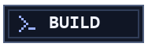
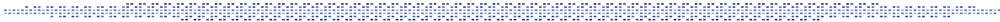

<h1 align="center">Sajda</h1>

  <strong>Prayer times at the edge of your screen.</strong> 
  Hover to see the next prayer and its live countdown. Sajda reminds you when it's time. 
  Open from the Windows notification area, or hover at the top, left, or right edge.

  
  &nbsp;
  

  
  
  
  
  
  

  
  
  

<blockquote>
  
<strong>Offline use.</strong> Once Sajda has downloaded your city's prayer times, you can use the saved schedule offline while it still covers the current date.

</blockquote>

<h2>Why Sajda</h2>

When you want to know how long remains until the next prayer, move your pointer to the screen edge. Sajda shows today's schedule and a countdown for your selected city.

<table>
  <tr>
    <td width="33%" align="center" valign="top">
       
      <strong>Choose your city</strong> 
      Search by name and select your city to load its local prayer times.
    </td>
    <td width="33%" align="center" valign="top">
       
      <strong>Hover to check</strong> 
      See all five daily prayers and how long remains until the next one.
    </td>
    <td width="33%" align="center" valign="top">
       
      <strong>Get a reminder</strong> 
      See an illustrated alert and choose Chime, Soft, or Silent.
    </td>
  </tr>
</table>

<h2>Preview</h2>

Sajda uses a different illustration for each prayer in the countdown and reminder cards. Here is the artwork for Maghrib.

<h2>Features</h2>

<ul>
  <li><strong>Daily schedule.</strong> See Fajr, Dhuhr, Asr, Maghrib, and Isha in your selected city's time zone.</li>
  <li><strong>Customizable screen edge.</strong> Pick the position, hover area, trigger thickness, and opening delay.</li>
  <li><strong>English and Arabic.</strong> Switch languages, with a right-to-left layout for Arabic.</li>
  <li><strong>Windows tray.</strong> Reopen Sajda from the notification area and choose whether it starts when you sign in.</li>
</ul>

<h2>Install on Windows</h2>

Download the Windows x64 setup file from <a href="https://github.com/razak-tech/Sajda/releases">GitHub Releases</a>, or use the <a href="#build">build commands below</a> to generate it locally. The build writes the installer to <code>src-tauri/target/release/bundle/nsis/</code>.

<h2>Privacy</h2>

Sajda stores your preferences and cached prayer schedule locally. Open-Meteo supplies city search results, and AlAdhan supplies the prayer schedule for your selected coordinates and time zone. The optional approximate city lookup uses your public IP address.

<h2>Build from source</h2>

From the repository root on Windows, with the Tauri build prerequisites installed, run:

<pre><code>npm ci
.\node_modules\.bin\tauri.cmd build --bundles nsis --ci</code></pre>

<a href="UI-AND-USER-FLOW.md">User guide and component map</a> · <a href="VERIFICATION.md">Windows verification</a>

