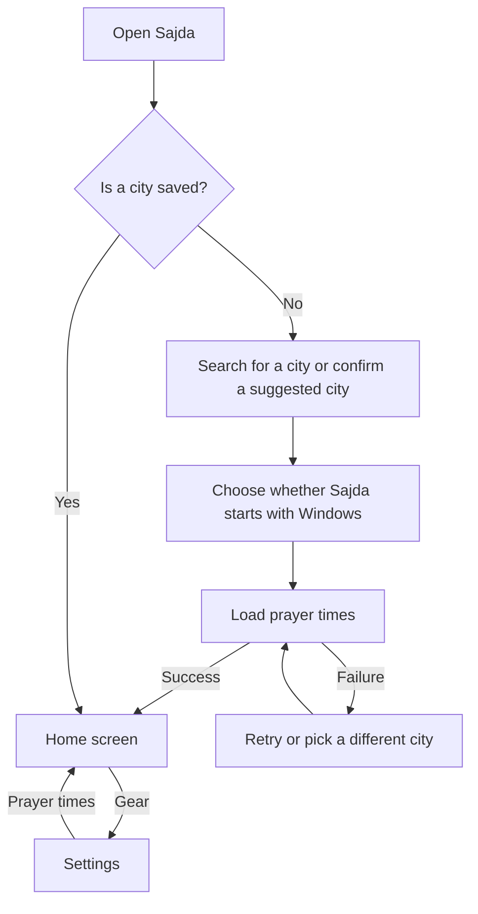

# Sajda UI Components and User Flow

Sajda is a Windows app for checking local prayer times and receiving reminders. Its screen-edge window contains the schedule, setup, and settings. The same panel stays in place while the content changes.

## UI components

| Component | What it shows and how it works |
| --- | --- |
| **Title bar** | Shows the Sajda logo and a close button. Settings shows a Prayers shortcut to return to the schedule. |
| **Location and clock** | Shows the selected city beside a pin, its current local time, and a Settings shortcut above the next prayer. |
| **Next prayer card** | Shows the automatic countdown, the scheduled time, and artwork for the upcoming prayer. After Isha, the card labels the next day's Fajr as tomorrow when its schedule is available. |
| **Daily prayer list** | Shows the scheduled times for Fajr, Dhuhr, Asr, Maghrib, and Isha. The next prayer is emphasized when it falls today. |
| **Screen-edge panel** | A small strip at the top, left, or right edge of the screen expands on hover. Moving the pointer away collapses a hover preview. Opening Settings keeps the panel open and changes the view in place. |
| **Prayer reminder** | A dismissible card shows the matching artwork, prayer name, and time when a prayer starts. Playback follows the selected reminder sound, including the Silent option. |
| **Setup controls** | Include English or Arabic, a searchable city picker, an option to request an approximate city suggestion, and a Start with Windows switch. Arabic uses a right-to-left layout. |

### Settings

| Section | Controls |
| --- | --- |
| **Location** | View the current city, search for a different one, or request an approximate city suggestion based on your public IP address. |
| **Appearance** | Choose the light or dark theme. Sajda saves the selection. |
| **Notifications** | Choose Chime, Soft, or Silent. Preview either audible option. |
| **Screen edge** | Choose Top, Left, Right, or Off. Set the hover area length to Small, Medium, or Large, and adjust the trigger thickness from 1 to 12 physical pixels. Set the corner radius, opening delay, and edge sounds. |
| **General** | Change the interface language or toggle Start with Windows. |

## User flow

1. **First launch.** Choose a language and city, then decide whether to launch Sajda at Windows sign-in. Once the schedule loads, Sajda opens the home screen. If loading fails, retry or return to city selection.
2. **Daily use.** Hover over the edge strip or open Sajda from the notification area to see today's prayer times and the illustrated next-prayer countdown. At prayer time, Sajda shows a reminder and uses the selected sound. Setting the edge position to Off hides the strip while keeping reminders available.
3. **Change city.** Open **Settings → Location** and select another city. The current city's schedule and reminders stay active while Sajda loads the new schedule. Sajda returns to Settings after a successful switch. If loading fails, you can retry or keep the current city.
4. **Return or close.** Select **Prayers** in the panel header or press **Esc** in Settings to return to the schedule. The **×** button collapses the panel so Sajda can keep running in the background. Click the Sajda icon in the Windows notification area to reopen it. Choose **Quit** from the icon's menu to stop the app completely.

## Source files

- [App.tsx](src/App.tsx) handles setup, navigation, and settings.
- [PrayerPanel.tsx](src/PrayerPanel.tsx) renders the prayer schedule and countdown.
- [Edge.tsx](src/Edge.tsx) renders the shared screen-edge window, navigation, and reminder card.
- [tray.rs](src-tauri/src/tray.rs) handles the Windows notification area menu and window visibility.
